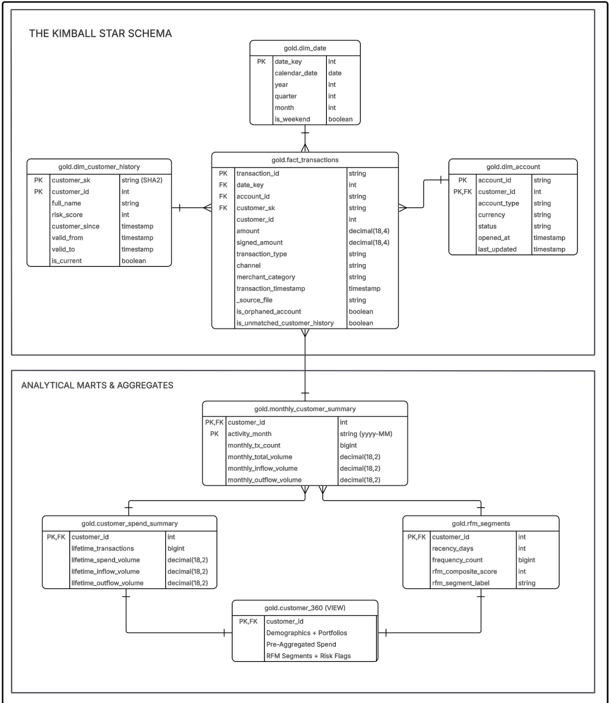

# Banking Lakehouse & Customer 360 Platform

Banks typically store customer master data and account states in operational systems (Azure SQL) while high-volume transaction events land as files in cloud storage (Amazon S3). These silos make it difficult to:

- Maintain accurate historical customer profiles (SCD Type 2)
- Reconstruct point-in-time risk attributes for regulatory reporting
- Deliver a unified Customer 360 view without expensive full-table scans
- Apply consistent data quality rules and incremental processing

This project implements a **Banking Lakehouse & Customer 360 Platform** on Databricks using Serverless compute and Lakeflow Declarative Pipelines. It ingests data from Azure SQL and Amazon S3, applies Medallion architecture with AUTO CDC, enforces data quality expectations, builds a dimensional star schema, behavioral RFM segmentation, and an optimized, zero-recompute virtual Customer 360 mart.

## Table of Contents

1. [Architecture Overview](#architecture-overview)

2. [Data Flow & Medallion Pipeline](#data-flow--medallion-pipeline)

3. [Physical Schemas & Data Dictionaries](#physical-schemas--data-dictionaries)

4. [Dimensional Star Schema & Mart Design](#dimensional-star-schema--mart-design)

5. [Design Decisions](#design-decisions)

6. [Repository & Directory Structure](#repository--directory-structure)

7. [Deployment & Operational Runbook](#deployment--operational-runbook)

8. [Future Enterprise Scope](#future-enterprise-scope)

## Architecture Overview

```
                                      MULTI-SOURCE INGESTION LAYER
┌───────────────────────────────────────┐                    ┌───────────────────────────────────────┐
│     Azure SQL Database (OLTP)         │                    │        Amazon S3 Bucket               │
│ - dbo.customers (Profile mutations)   │                    │ - s3://bank-landing/transactions/     │
│ - dbo.accounts  (Balance & Status)    │                    │ - Streaming JSON Event Payloads       │
└──────────────────┬────────────────────┘                    └──────────────────┬────────────────────┘
                   │                                                            │
═══════════════════╪════════════════════════════════════════════════════════════╪═════════════════════════════
                   │ DATABRICKS WORKFLOW ORCHESTRATION (SCHEDULED BATCH JOB)    │
═══════════════════╪════════════════════════════════════════════════════════════╪═════════════════════════════
                   ▼                                                            │
┌────────────────────────────────────────────────────────┐                      │
│ TASK 1: Serverless Python Ingestion Task               │                      │
│ File: tasks/00_ingest_azure_sql.py                     │                      │
│ - Evaluates MAX(last_updated) watermark from Delta log │                      │
│ - Appends rows to Bronze Delta tables                  │                      │
│ - Runtime: ~10-15s (Zero idle compute)                 │                      │
└──────────────────────────┬─────────────────────────────┘                      │
                           │ depends_on (Automatic trigger)                     │
                           ▼                                                    ▼
┌────────────────────────────────────────────────────────────────────────────────────────────────────────┐
│ TASK 2: Lakeflow Declarative Pipeline (Triggered Batch Mode)                                           │
│                                                                                                        │
│  [BRONZE LAYER - Append-Only & Schema Evolution]                                                       │
│  - bronze.customers_raw    : Delta append stream                                                       │
│  - bronze.accounts_raw     : Delta append stream                                                       │
│  - bronze.transactions_raw : Auto Loader (`read_files`) streaming ingestion from S3                    │
│                                                                                                        │
│  [SILVER LAYER - Data Quality& AUTO CDC]                                                               │
│  - silver.transactions_clean : Delta table, standardization                                            │
│  - silver.customers_history  : AUTO CDC SCD Type 2 (__START_AT, __END_AT, tombstone deletes)           │
│  - silver.accounts_current   : AUTO CDC SCD Type 1 (In-place operational state upserts)                │
│                                                                                                        │
│  [GOLD LAYER - Star Schema, Audited Facts & Scalable Rollups]                                          │
│  - gold.dim_date             : Generated calendar                                                      │
│  - gold.dim_customer_history : Full SCD2 dimension with deterministic SHA-256 surrogate keys (SKs)    │
│  - gold.dim_customer         : Active dimension slice (current active version)                         │
│  - gold.dim_account          : Operational product dimension                                           │
│  - gold.fact_transactions   : Point-in-Time As-Of range joined fact (stamped with customer_sk)         │
│  - gold.monthly_customer_summary : Longitudinal periodic snapshot rollup fact                          │
│  - gold.customer_spend_summary   : Pre-aggregated lifetime metrics derived from monthly summaries      │
│  - gold.rfm_segments        : Decoupled behavioral quintiles anchored to Lakehouse event time         │
│  - gold.customer_360        : Standard SQL View (Zero-scan runtime join over pre-computed entities)   │
└────────────────────────────────────────────────────────────────────────────────────────────────────────┘


```

## Data Flow & Medallion Pipeline

### Bronze Layer (Raw Landing & Append-Only Log)

- **`bronze.transactions_raw`**: Ingested continuously from Amazon S3 via Databricks Auto Loader (`read_files`). Configured with `schemaEvolutionMode => 'addNewColumns'` and system tracking attributes (`_source_file`, `_ingest_timestamp`).

- **`bronze.customers_raw` & `bronze.accounts_raw`**: Append-only Delta tables fed by Task 1 serverless Python JDBC extraction.

### Silver Layer (Cleansing, Data Quality & AUTO CDC)

- **`silver.transactions_clean`**: Streaming table applying strict Lakeflow Expectations, casting amounts to `DECIMAL(18, 4)`, and generating deterministic signed amounts (`signed_amount` is positive for deposits/refunds and negative for withdrawals/purchases).

- **`silver.customers_history` (SCD Type 2)**: Maintained via `AUTO CDC`. Historizes profile mutations (risk score, KYC status, contact info, customer segment). Handles soft deletes via `APPLY AS DELETE WHEN is_deleted = 1`.

- **`silver.accounts_current` (SCD Type 1)**: Operational account snapshots updated in-place via `AUTO CDC ... STORED AS SCD TYPE 1`.

### Gold Layer (Dimensional Serving & Rollup Marts)

- **`gold.dim_date`**: Comprehensive reference calendar.

- **`gold.dim_customer_history`**: Full SCD Type 2 dimension exposing valid date ranges (`valid_from`, `valid_to`) and deterministic surrogate keys (`customer_sk`).

- **`gold.dim_customer`**: Active customer dimension filtered on `WHERE is_current = TRUE`.

- **`gold.dim_account`**: Current operational view of all bank accounts and balances.

- **`gold.fact_transactions`**: Core fact table joined via As-Of range to historical customer profiles and flagged for orphaned accounts (`is_orphaned_account`).

- **`gold.monthly_customer_summary`**: Periodic longitudinal rollup aggregating monthly transaction counts, inflow/outflow volumes, and channel usage.

- **`gold.customer_spend_summary`**: Lifetime cumulative spend, velocity, and preferred channel aggregates per customer.

- **`gold.rfm_segments`**: Behavioral quintile scoring (1–5) based on event-time anchored recency, frequency, and monetary values.

- **`gold.customer_360`**: Virtual unified serving view joining master demographics, account distributions, lifetime spend, RFM segments, and compliance risk flags.

## Physical Schemas

Check out the [Schema Guide](schema_guide.md) for more details.

## Dimensional Star Schema & Mart Design



## Design Decisions

### 1. Separating Azure SQL Ingestion from the Main Pipeline

Lakeflow works best with streaming sources. Standard JDBC reads from Azure SQL are batch-oriented, which made reliable incremental loading difficult inside the pipeline.

Azure SQL extraction was therefore moved to a separate serverless task. This task uses a watermark on `last_updated` to pull only new or changed rows into Bronze. The Lakeflow pipeline then starts from the Bronze Delta tables.

This keeps incremental loads clean and removes the dependency on Azure SQL being online during every pipeline run.

### 2. Preserving Historical Customer State

Customer attributes such as risk score, segment, and contact details change over time. Using only the latest version would cause historical transactions to pick up incorrect attributes.

Customer data is maintained as SCD Type 2. When building the fact table, each transaction is joined to the customer version that was valid at the time of the transaction (As-Of join on `__START_AT` / `__END_AT`). A deterministic surrogate key is also generated so the historical link remains stable.

This ensures point-in-time correctness for reporting and risk analysis.

### 3. Reducing Recompute Cost for Customer 360 and RFM

Calculating lifetime metrics directly from raw transactions is expensive, especially when multiple users or Genie queries hit the same logic. Global ranking functions used in RFM are also costly if recomputed on every run.

Transactions are first aggregated into monthly summaries, then rolled up into lifetime summaries. RFM scoring runs only on the pre-aggregated customer metrics and is kept as a separate materialized view. `customer_360` itself is implemented as a standard SQL view that joins the already-prepared tables.

As a result, most of the heavy work is done once during the pipeline, and interactive queries stay lightweight.

## Repository & Directory Structure

```
banking-lakehouse/
├── .gitignore                             # Ignores local checkpoints, pycache, and secrets
├── README.md                              # Enterprise system architecture documentation
├── datagen/
│   ├── datagen_and_cdc_simulator.py       # Local Python engine for seeding Azure SQL and S3
│   └── requirements.txt                   # Generation dependencies (faker, pyodbc, boto3)
├── tasks/
│   └── 00_ingest_azure_sql.py             # Task 1: Serverless watermarked JDBC delta extraction
├── pipeline/
│   ├── 01_bronze_s3.sql                   # Task 2: Auto Loader S3 streaming ingestion
│   ├── 02_silver.sql                      # Task 2: Cleaned, liquid-clustered Silver & AUTO CDC
│   └── 03_gold.sql                        # Task 2: Point-in-Time Fact, rollups, and Customer 360
└── ddl/
    └── 00_init_ddl.sql                # Azure DB tables setup


```

## Deployment & Operational Runbook

### 1. Metastore Bootstrap (Databricks SQL)

Execute `ddl/00_init_catalog.sql` in a Databricks Serverless SQL Warehouse:

```
CREATE CATALOG IF NOT EXISTS banking_lakehouse;
CREATE SCHEMA IF NOT EXISTS banking_lakehouse.bronze;
CREATE SCHEMA IF NOT EXISTS banking_lakehouse.silver;
CREATE SCHEMA IF NOT EXISTS banking_lakehouse.gold;
```

### 2. Configure Unity Catalog Secret Scope

In Databricks Notebook, register external Azure SQL credentials:

```
%python
from databricks.sdk import WorkspaceClient
w = WorkspaceClient()

w.secrets.put_secret(scope="banking_scope", key="azure_sql_jdbc_url", string_value="jdbc:sqlserver://<server>.database.windows.net:1433;database=banking-oltp;encrypt=true;trustServerCertificate=false;")
w.secrets.put_secret(scope="banking_scope", key="azure_sql_user", string_value="<user>")
w.secrets.put_secret(scope="banking_scope", key="azure_sql_password", string_value="<password>")

```

### 3. Generate Baseline Data

From a local terminal, seed Azure SQL and stage baseline transactions to S3:

```
pip install -r datagen/requirements.txt

# Create/update .env in project root
S3_BUCKET_NAME=bucket-name
AWS_REGION=your_region
AWS_ACCESS_KEY_ID=<your-key>
AWS_SECRET_ACCESS_KEY=<your-secret>
SQL_SERVER=<server>.database.windows.net
SQL_PORT=<port>
SQL_DATABASE=<your-db>
SQL_USER=<user>
SQL_PASSWORD=<password>

# Run — seeds Azure SQL (customers + accounts) AND uploads 7-day transactions to S3
python mock_data/datagen_and_cdc_simulator.py --mode initial

```

### 4. Configure Databricks Workflow

1. Navigate to **Workflows** $\rightarrow$ **Jobs** $\rightarrow$ **Create Job** (`Job_Daily_Banking_Lakehouse_Batch`).

2. **Task 1 (`ingest_azure_sql_to_bronze`)**:
   - **Type**: `Notebook`

   - **Source**: (`tasks/00_ingest_azure_sql.py`)

   - **Compute**: `Serverless`

3. **Task 2 (`run_lakeflow_pipeline`)**:
   - **Type**: `Pipeline`

   - **Pipeline**: Point to Lakeflow pipeline configured with `pipeline/01_bronze_s3.sql`, `pipeline/02_silver.sql`, and `pipeline/03_gold.sql`.

   - **Target Catalog**: `banking_lakehouse`

   - **Depends On**: `ingest_azure_sql_to_bronze`

### 5. Day-2 CDC Simulation & Incremental Verification

Inject customer mutations (credit score shifts, address changes, soft deletions) and new transaction files:

```
python datagen/datagen_and_cdc_simulator.py --mode cdc
```

Trigger `Job_Daily_Banking_Lakehouse_Batch` in Databricks Workflows. Inspect the execution:

1. **Task 1** fetches modified rows via watermarked query and appends to Bronze (\~10 seconds).

2. **Task 2** streams deltas through Silver, closes historical SCD2 records in `silver.customers_history`, performs As-Of joins for `gold.fact_transactions`, updates `gold.monthly_customer_summary`, and refreshes `gold.customer_360` with zero downtime.

## Future Scope

1. **Unity Catalog Dynamic Data Masking**:
   - Implement SQL UDFs (`mask_email()`, `mask_phone()`) directly in Unity Catalog to dynamically redact PII for general business analysts while revealing plaintext values to compliance officers.

2. **Row-Level Security (RLS)**:
   - Enforce data residency and sovereignty boundaries via `ROW FILTER` policies on `gold.dim_customer` and `gold.customer_360` based on user group membership (e.g., US vs. EMEA regulatory access).

3. **Automated CI/CD via Databricks Asset Bundles (DABs)**:
   - Package all workflow tasks, Lakeflow pipeline definitions, and Unity Catalog schemas into declarative YAML bundles deployed via GitHub Actions.
